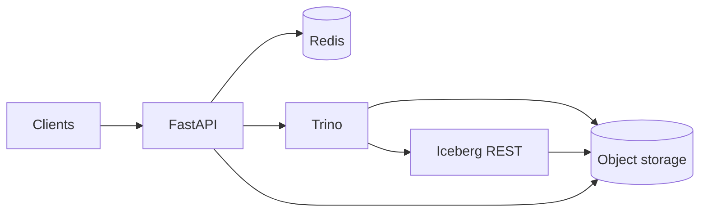

# Data Lake API

Serve a lakehouse over HTTP instead of shipping CSV files. An Iceberg table of synthetic card transactions sits on S3-compatible storage. Trino reads it. A FastAPI service pages through it, caches point lookups in Redis, and writes large extracts to Parquet with a presigned URL.

All data is generated with Faker. No real customer or company data is used.



The three flows, and why Trino is not on the hot path, are in [Architecture](docs/architecture.md).

## Quick start

Docker with Compose v2, `make`, `curl`, and Python 3. About 6 GB of free RAM. Linux, macOS, and Windows via WSL2 are covered in [Getting started](docs/getting-started.md).

```bash
git clone https://github.com/ccheitor/data-lake-api.git
cd data-lake-api
make up                  # build, start, wait for /health
make seed ROWS=2000000   # fake transactions, last 90 days
make test                # auth, pagination, masking, cache, export
```

If your user cannot talk to the Docker socket: `make up DOCKER='sudo docker'`.

| URL | |
|---|---|
| http://localhost:8000/docs | Swagger UI |
| http://localhost:9001 | Storage console (user and password from `.env`) |
| http://localhost:8080 | Trino UI |

Default keys, in `.env.example`: `dev-analyst-key` sees masked card and CPF, `dev-admin-key` sees clear values. Change them outside a private laptop.

`make down` stops containers and keeps data. `make clean` deletes the volumes.

## Documentation

| Guide | |
|---|---|
| [Architecture](docs/architecture.md) | Components, sequence diagrams, Trino vs DuckDB, Iceberg, cursors, async export |
| [Getting started](docs/getting-started.md) | Linux, macOS, Windows/WSL2, and common failures |
| [API reference](docs/api-reference.md) | Endpoints, roles, errors, pagination, masking |
| [Configuration](docs/configuration.md) | Environment variables and every Makefile target |
| [Data model](docs/data-model.md) | Columns, `day(ts)` partitions, sort order, generator flags |
| [Security](docs/security.md) | Keys, masking, audit log, production gaps |
| [Performance](docs/performance.md) | How to run k6 and Locust, the measured run, and [file vs lake size](loadtest/STORAGE.md) |
| [Deployment](docs/deployment.md) | Laptop, [Oracle Cloud Always Free](docs/oracle-cloud-free.md), a VPS, an AWS sketch |
| [Roadmap](docs/roadmap.md) | Kafka, OAuth, Kubernetes, Arrow Flight, a UI, maintenance |

On the published load test (2,000,000 rows, shared 8 vCPU VM, k6 on the same host), a direct Trino lookup did 4.0 requests/s and the same lookup against a warm cache did 2,632.6 requests/s. Full table, hardware, and caveats: [Performance](docs/performance.md).

The same 2,000,000 rows occupy 292,630,765 bytes as uncompressed CSV, 67,355,337 bytes as an Iceberg table, and 37,867,262 bytes as one ZSTD Parquet file. Method and the rest of the formats: [loadtest/STORAGE.md](loadtest/STORAGE.md).

## Layout

```
docker-compose.yml     storage, Iceberg REST, Trino, Redis, API, seed
Makefile               up, seed, test, loadtest, down, clean
api/                   FastAPI service and the Faker generator
trino/                 coordinator and Iceberg catalog
loadtest/              k6, Locust, RESULTS.md, STORAGE.md
scripts/               wait-healthy.sh, smoke-test.sh
docs/                  the guides linked above
```

## Resumo em português

Em muitos sistemas, principalmente em bancos e meios de pagamento, o dado ainda sai como arquivo: CSV no SFTP, planilha por e-mail, um chamado para "o mesmo extrato com uma coluna a mais". O atraso é de um dia, cada necessidade vira um job novo, cópias de dado sensível se espalham e ninguém sabe quem recebeu o quê.

Este repositório troca esse fluxo por uma API na frente de um lakehouse. Os dados ficam numa tabela Apache Iceberg (Parquet em armazenamento compatível com S3). O Trino executa o SQL. A API em FastAPI oferece três acessos:

1. **Consulta paginada** com filtros e cursor (keyset), sempre com intervalo de datas, para o particionamento por dia eliminar arquivos.
2. **Consulta pontual por cliente**, com cache Redis. É o caminho de alto TPS. O Trino paga um custo fixo de planejamento em toda consulta, então não serve para milhares de lookups por segundo.
3. **Exportação assíncrona**: a API responde na hora, um worker grava Parquet e devolve uma URL pré-assinada.

Também há chave de API, mascaramento de cartão e CPF dentro do SQL (o papel `analyst` não vê o valor claro, nem no arquivo exportado), log de auditoria em JSON e um gerador de transações falsas com Faker. Não há dado real.

Subir localmente:

```bash
git clone https://github.com/ccheitor/data-lake-api.git
cd data-lake-api
make up
make seed ROWS=200000
make test
```

`make up` sobe a stack e espera o `/health`. `make seed` gera transações fictícias (200 mil linhas nesse exemplo; o padrão do Makefile é 2 milhões). `make test` percorre autenticação, paginação, máscara, cache e download. No teste de carga: `make loadtest-all HOT=200`.

Chaves locais: `dev-analyst-key` (mascarada) e `dev-admin-key` (valor claro). Troque-as no `.env` se a máquina não for só sua.

Os guias detalhados estão em inglês na pasta [docs/](docs/README.md): arquitetura, referência da API, configuração, segurança, desempenho e deploy. Para a Oracle Cloud Always Free (VM Arm Ampere A1), siga [docs/oracle-cloud-free.md](docs/oracle-cloud-free.md).

No teste medido deste projeto (2 milhões de linhas, VM compartilhada de 8 vCPUs, k6 na mesma máquina), a consulta pontual direto no Trino fez 4 req/s e a mesma consulta com cache quente fez 2.632,6 req/s, com p95 de 5,2 ms. A tabela completa está em [docs/performance.md](docs/performance.md).

As mesmas 2.000.000 linhas ocupam 292.630.765 bytes em CSV sem compressão, 67.355.337 bytes na tabela Iceberg e 37.867.262 bytes num único Parquet ZSTD. O restante dos formatos está em [loadtest/STORAGE.md](loadtest/STORAGE.md).
