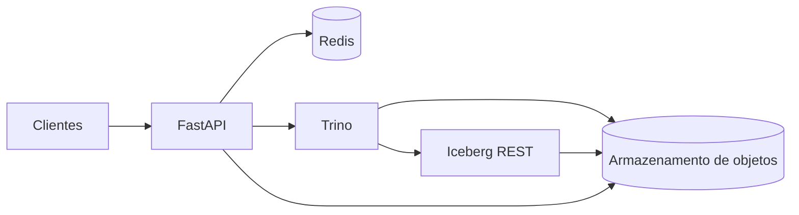
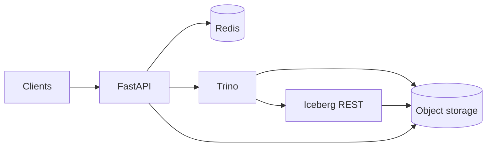

# Data Lake API

[Português](#portugues) | [English](#english)

<a id="portugues"></a>

## Português

Sirva um lakehouse por HTTP em vez de enviar arquivos CSV. Uma tabela Iceberg de transações de cartão sintéticas fica num armazenamento compatível com S3. O Trino lê. Um serviço FastAPI pagina, guarda consultas pontuais no Redis e grava extratos grandes em Parquet com uma URL pré-assinada.

Todo o dado é produzido com Faker. Não se usa dado real de cliente ou de empresa.



Os três fluxos, e por que o Trino não está no caminho quente, estão em [Arquitetura](docs/pt-BR/architecture.md).

### Início rápido

Docker com Compose v2, `make`, `curl` e Python 3. Cerca de 6 GB de RAM livre. Linux, macOS e Windows via WSL2 estão em [Primeiros passos](docs/pt-BR/getting-started.md).

```bash
git clone https://github.com/ccheitor/data-lake-api.git
cd data-lake-api
make up                  # constroi, sobe, espera /health
make seed ROWS=2000000   # transacoes falsas, ultimos 90 dias
make test                # auth, paginacao, mascara, cache, exportacao
```

Se o seu usuário não fala com o socket do Docker: `make up DOCKER='sudo docker'`.

| URL | |
|---|---|
| http://localhost:8000/docs | Swagger UI |
| http://localhost:9001 | Console do armazenamento (usuário e senha do `.env`) |
| http://localhost:8080 | UI do Trino |

Chaves padrão, em `.env.example`: `dev-analyst-key` vê cartão e CPF mascarados, `dev-admin-key` vê os valores claros. Troque-as fora de um laptop privado.

`make down` para os contêineres e conserva os dados. `make clean` apaga os volumes.

### Documentação

| Guia | |
|---|---|
| [Arquitetura](docs/pt-BR/architecture.md) | Componentes, diagramas de sequência, Trino contra DuckDB, Iceberg, cursores, exportação assíncrona |
| [Primeiros passos](docs/pt-BR/getting-started.md) | Linux, macOS, Windows/WSL2 e falhas comuns |
| [Referência da API](docs/pt-BR/api-reference.md) | Endpoints, papéis, erros, paginação, mascaramento |
| [Configuração](docs/pt-BR/configuration.md) | Variáveis de ambiente e cada alvo do Makefile |
| [Modelo de dados](docs/pt-BR/data-model.md) | Colunas, partições `day(ts)`, ordem, flags do gerador |
| [Segurança](docs/pt-BR/security.md) | Chaves, mascaramento, log de auditoria, lacunas de produção |
| [Desempenho](docs/pt-BR/performance.md) | Como rodar k6 e Locust, a execução medida e o [tamanho arquivo contra lago](loadtest/STORAGE.md) |
| [Implantação](docs/pt-BR/deployment.md) | Laptop, [Oracle Cloud Always Free](docs/pt-BR/oracle-cloud-free.md), uma VPS, um esboço na AWS |
| [Roteiro](docs/pt-BR/roadmap.md) | Kafka, OAuth, Kubernetes, Arrow Flight, uma UI, manutenção |

No teste de carga publicado (2,000,000 linhas, VM compartilhada de 8 vCPU, k6 no mesmo host), um lookup direto no Trino fez 4.0 requisições/s e o mesmo lookup contra cache quente fez 2,632.6 requisições/s. Tabela completa, hardware e ressalvas: [Desempenho](docs/pt-BR/performance.md).

As mesmas 2,000,000 linhas ocupam 292,630,765 bytes como CSV sem compressão, 67,355,337 bytes como tabela Iceberg e 37,867,262 bytes como um arquivo Parquet ZSTD. Método e o resto dos formatos: [loadtest/STORAGE.md](loadtest/STORAGE.md).

### Organização

```
docker-compose.yml     armazenamento, Iceberg REST, Trino, Redis, API, seed
Makefile               up, seed, test, loadtest, down, clean
api/                   servico FastAPI e o gerador Faker
trino/                 coordinator e catalogo Iceberg
loadtest/              k6, Locust, RESULTS.md, STORAGE.md
scripts/               wait-healthy.sh, smoke-test.sh
docs/pt-BR/            estes guias em portugues
docs/en/               os mesmos guias em ingles
```

<a id="english"></a>

## English

Serve a lakehouse over HTTP instead of shipping CSV files. An Iceberg table of synthetic card transactions sits on S3-compatible storage. Trino reads it. A FastAPI service pages through it, caches point lookups in Redis, and writes large extracts to Parquet with a presigned URL.

All data is generated with Faker. No real customer or company data is used.



The three flows, and why Trino is not on the hot path, are in [Architecture](docs/en/architecture.md).

### Quick start

Docker with Compose v2, `make`, `curl`, and Python 3. About 6 GB of free RAM. Linux, macOS, and Windows via WSL2 are covered in [Getting started](docs/en/getting-started.md).

```bash
git clone https://github.com/ccheitor/data-lake-api.git
cd data-lake-api
make up                  # build, start, wait for /health
make seed ROWS=2000000   # fake transactions, last 90 days
make test                # auth, pagination, masking, cache, export
```

If your user cannot talk to the Docker socket: `make up DOCKER='sudo docker'`.

| URL | |
|---|---|
| http://localhost:8000/docs | Swagger UI |
| http://localhost:9001 | Storage console (user and password from `.env`) |
| http://localhost:8080 | Trino UI |

Default keys, in `.env.example`: `dev-analyst-key` sees masked card and CPF, `dev-admin-key` sees clear values. Change them outside a private laptop.

`make down` stops containers and keeps data. `make clean` deletes the volumes.

### Documentation

| Guide | |
|---|---|
| [Architecture](docs/en/architecture.md) | Components, sequence diagrams, Trino vs DuckDB, Iceberg, cursors, async export |
| [Getting started](docs/en/getting-started.md) | Linux, macOS, Windows/WSL2, and common failures |
| [API reference](docs/en/api-reference.md) | Endpoints, roles, errors, pagination, masking |
| [Configuration](docs/en/configuration.md) | Environment variables and every Makefile target |
| [Data model](docs/en/data-model.md) | Columns, `day(ts)` partitions, sort order, generator flags |
| [Security](docs/en/security.md) | Keys, masking, audit log, production gaps |
| [Performance](docs/en/performance.md) | How to run k6 and Locust, the measured run, and [file vs lake size](loadtest/STORAGE.md) |
| [Deployment](docs/en/deployment.md) | Laptop, [Oracle Cloud Always Free](docs/en/oracle-cloud-free.md), a VPS, an AWS sketch |
| [Roadmap](docs/en/roadmap.md) | Kafka, OAuth, Kubernetes, Arrow Flight, a UI, maintenance |

On the published load test (2,000,000 rows, shared 8 vCPU VM, k6 on the same host), a direct Trino lookup did 4.0 requests/s and the same lookup against a warm cache did 2,632.6 requests/s. Full table, hardware, and caveats: [Performance](docs/en/performance.md).

The same 2,000,000 rows occupy 292,630,765 bytes as uncompressed CSV, 67,355,337 bytes as an Iceberg table, and 37,867,262 bytes as one ZSTD Parquet file. Method and the rest of the formats: [loadtest/STORAGE.md](loadtest/STORAGE.md).

### Layout

```
docker-compose.yml     storage, Iceberg REST, Trino, Redis, API, seed
Makefile               up, seed, test, loadtest, down, clean
api/                   FastAPI service and the Faker generator
trino/                 coordinator and Iceberg catalog
loadtest/              k6, Locust, RESULTS.md, STORAGE.md
scripts/               wait-healthy.sh, smoke-test.sh
docs/pt-BR/            these guides in Portuguese
docs/en/               the same guides in English
```
