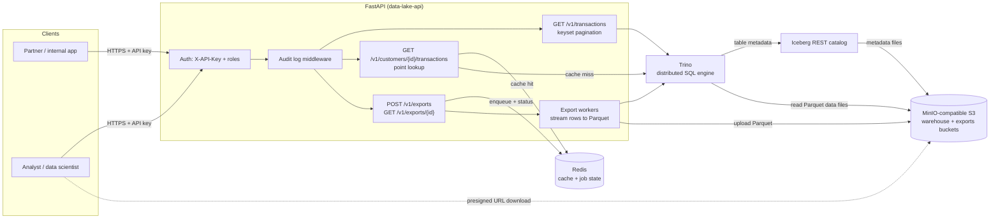

# Data Lake API — serve big data over HTTP instead of exchanging files

A runnable lakehouse that replaces "send me the CSV over SFTP" with an authenticated,
audited API on top of an Apache Iceberg data lake:

* **Paginated queries** with filters and keyset (cursor) pagination — Trino over Iceberg
* **Point lookups** (transactions of a customer) with a Redis cache — the high-TPS path
* **Async bulk exports** — a big query is streamed to Parquet in object storage and the
  client gets a presigned URL
* API-key auth, role-based **column masking** (card number / CPF), JSON **audit log**, health checks
* Fake-but-realistic **card transaction generator** (Faker + NumPy, millions of rows in seconds)
* **k6 load tests** comparing direct-Trino vs cached endpoints
* Runs on a 16 GB laptop and on **Arm64** (Oracle Cloud Ampere A1) — see [docs/oracle-cloud-free.md](docs/oracle-cloud-free.md)

> All data is synthetic (generated with Faker). No real customer or company data is used.

---

## The problem: file exchange doesn't scale

In many companies, and especially in banking and payments, data still moves between
teams and partners as files: a nightly CSV or fixed-width TXT dropped on an SFTP server,
an Excel sheet attached to an email, a ticket to ask for "the same extract, but with one more column".

That process is slow and bureaucratic:

| File exchange | Data API on a lake |
|---|---|
| D+1 at best; consumers wait for the batch | Query what is already in the lake, when you need it |
| Every new need = new extract, new ticket, new job | Consumers filter and paginate themselves |
| Copies of sensitive data spread across mailboxes and shares | Data stays in one place; masking enforced by role |
| Hard to know who received what | Every request is in an audit log |
| Schema changes break parsers silently | Typed schema (Iceberg) and a versioned API contract |
| Full re-sends to fix one row | Consumers re-query; exports are reproducible |

This project shows the architecture companies use to fix that, small enough to run on a laptop.

## Architecture



| Component | Role | Image (all amd64 + arm64) |
|---|---|---|
| Object storage | S3 API for the lake (`warehouse`) and exports (`exports`, 1-day lifecycle) | `pgsty/silo` (maintained MinIO fork, see note) |
| Iceberg REST catalog | Tracks tables, schemas, snapshots, partitions | `apache/iceberg-rest-fixture` |
| Trino 484 | SQL engine that reads Iceberg tables in parallel | `trinodb/trino` |
| Redis 7 | Cache for point lookups + export job state | `redis:7-alpine` |
| FastAPI | The data API | built from `api/` on `python:3.12-slim` |

> **Note on MinIO:** MinIO stopped publishing free container images (the `minio/minio`
> Docker Hub/Quay images are no longer pullable as of late 2026). This project uses
> [PGSTY Silo](https://silo.pigsty.io/), a maintained MinIO fork that keeps the same S3 API,
> `MINIO_*` env vars, console and `mc` client. Any S3-compatible store works
> (SeaweedFS, RustFS, AWS S3, OCI Object Storage) — only endpoints/credentials change.

**Table design** — `iceberg.payments.transactions` (14 columns), partitioned by `day(ts)`,
written sorted by `(customer_id, ts)` inside each file, Parquet + zstd:

* Date-range filters prune whole days (partition pruning).
* Sorting by customer gives tight Parquet min/max stats so point lookups skip most row groups.
* `amount` is `DECIMAL(12,2)` and returned as a string — money is never a float.

## Run it locally

Requirements: Docker with Compose v2, `make`, `curl`, Python 3 (only for the smoke-test
JSON parsing). ~6 GB free RAM. Works on Linux, macOS (Apple Silicon too) and WSL2.

```bash
git clone https://github.com/ccheitor/data-lake-api.git && cd data-lake-api
make up                 # builds the API, starts everything, waits for /health (Trino needs ~30-60 s)
make seed ROWS=2000000  # 2M fake transactions over the last 90 days (~10 s on a laptop)
make test               # end-to-end smoke test of every endpoint
```

If your user is not in the `docker` group: `make up DOCKER='sudo docker'` (same for the other targets).

Useful URLs:

* API docs (Swagger): http://localhost:8000/docs
* Object storage console: http://localhost:9001 (user/password from `.env`)
* Trino UI: http://localhost:8080 (any username)

Other targets: `make logs`, `make ps`, `make down` (keeps data), `make clean` (deletes volumes).
Seed more data with `make seed ROWS=20000000` (the generator commits in 250k-row batches,
so memory stays flat).

Default API keys (change them in `.env`):

| Key | Role | Sees |
|---|---|---|
| `dev-analyst-key` | analyst | card number and CPF **masked** |
| `dev-admin-key` | admin | clear values (and can read any export job) |

## API examples

```bash
KEY="X-API-Key: dev-analyst-key"

# Health (no auth): checks Trino, Redis and object storage
curl -s localhost:8000/health
# {"status":"ok","checks":{"trino":"ok","redis":"ok","object_storage":"ok"}}

# 1) Filtered, keyset-paginated query (newest first). Date range is required (max 31 days)
#    so every query is partition-pruned; bigger ranges go through /v1/exports.
curl -s -H "$KEY" "localhost:8000/v1/transactions?date_from=2026-11-17&date_to=2026-11-24&merchant_category=travel&min_amount=500&limit=2"
# {"data":[{"transaction_id":"tx_...","ts":"2026-11-23T23:59:55.336474","customer_id":2,
#   "merchant_category":"travel","amount":"778.57","currency":"BRL","status":"approved",
#   "card_number":"**** **** **** 7844","customer_cpf":"***.***.***-25", ...}],
#  "count":2,"next_cursor":"WyIyMDI2LTEx..."}

# next page: pass the cursor back
curl -s -H "$KEY" "localhost:8000/v1/transactions?date_from=2026-11-17&date_to=2026-11-24&merchant_category=travel&min_amount=500&limit=2&cursor=WyIyMDI2LTEx..."

# 2) Point lookup with cache (look at the X-Cache header: MISS, then HIT)
curl -si -H "$KEY" "localhost:8000/v1/customers/1234/transactions?limit=20" | grep -i x-cache
# same query straight to Trino, bypassing the cache (used by the load test)
curl -si -H "$KEY" "localhost:8000/v1/customers/1234/transactions?limit=20&cache=false" | grep -i x-cache

# 3) Async bulk export -> Parquet -> presigned URL
curl -s -X POST -H "$KEY" -H 'Content-Type: application/json' localhost:8000/v1/exports \
     -d '{"date_from":"2026-08-26","date_to":"2026-11-24"}'
# {"job_id":"ff7c...","status":"queued","status_url":"/v1/exports/ff7c..."}

curl -s -H "$KEY" localhost:8000/v1/exports/ff7c...
# {"status":"succeeded","rows_written":2000000,"size_bytes":47740851,"duration_s":30.85,
#  "download_url":"http://localhost:9000/exports/2026/11/24/ff7c....parquet?X-Amz-...","download_expires_in_s":3600}

curl -s -o export.parquet "<download_url>"
python3 -c "import pyarrow.parquet as pq; print(pq.read_table('export.parquet').num_rows)"
```

Every request produces one audit line (stdout and `/var/log/api/audit.log` in the container):

```json
{"ts":"2026-11-24T09:12:34.446442+00:00","request_id":"5407ff75...","key_id":"ddd2c99c9421",
 "client":"172.18.0.1","method":"GET","path":"/v1/exports/ff7c...","query":null,"status":200,"duration_ms":2.7}
```

`key_id` is a SHA-256 fingerprint; the API key itself is never logged.

### How masking works

Masking is applied **inside the SQL** sent to Trino (`concat('**** **** **** ', substr(card_number, -4))`,
`regexp_replace(customer_cpf, ...)`), so clear-text PII never leaves the engine for roles that
should not see it — including in exported Parquet files. In production you would move this into
the engine/catalog policy layer (Trino access control, Apache Ranger, OPA) so every client, not
only this API, gets the same rules.

## How TPS works in this architecture

There is no single "TPS of the data lake". Two very different workloads hit a data API,
and they need different engines:

**1. High-TPS point lookups → low-latency layer (cache / OLTP store).**
"Give me the latest transactions of customer X" must answer in milliseconds, thousands of
times per second. A distributed engine like Trino is the wrong tool for that: every query pays
a fixed cost for parsing, planning, scheduling splits and listing Iceberg metadata, typically
hundreds of milliseconds, and it is built to run tens of heavy queries concurrently, not thousands
of tiny ones. So point lookups go through a cache-aside Redis layer (here) or, in production,
a key-value / OLTP store (Redis, Cassandra/ScyllaDB, DynamoDB, Postgres, ClickHouse) kept fresh
from the lake or from a Kafka stream.

**2. Large-volume reads → async bulk export (low TPS, huge throughput).**
"Give me every transaction of the last quarter" is not a request/response problem. The API
accepts the job (`202`), a worker streams the result from Trino into Parquet, and the client
downloads a file from object storage with a presigned URL. Few requests per second, but each
one moves millions of rows, and the API servers never hold the dataset in memory.

In between, the **paginated query** endpoint serves interactive, filtered reads: moderate TPS,
partition-pruned, with keyset pagination so deep pages stay as cheap as the first one
(no `OFFSET` scans).

### Measured on this stack

Real numbers from `make loadtest-all HOT=200 VUS=10 DURATION=60s` against 2,000,000 rows,
run once on a shared 8 vCPU x86 cloud VM (Intel Xeon, ~16 GB RAM) with k6 on the same host
and Trino limited to a 1.5 GB heap. Treat them as an order-of-magnitude comparison, not a
benchmark of your hardware — rerun them yourself. Details in [loadtest/RESULTS.md](loadtest/RESULTS.md).

| Scenario (10 virtual users, 60 s) | Requests/s | p50 | p95 | p99 | Errors |
|---|---:|---:|---:|---:|---:|
| Point lookup, **direct Trino** (`cache=false`) | 4.0 | 2,530 ms | 3,045 ms | 3,166 ms | 0% |
| Point lookup, cache **cold** (fills while running) | 94.8 | 2.9 ms | 6.6 ms | 2,723 ms | 0% |
| Point lookup, cache **warm** (100% hits) | 2,632.6 | 3.7 ms | 5.2 ms | 6.1 ms | 0% |
| Paginated query, 7-day window, 100 rows/page (Trino) | 37.9 | 273 ms | 340 ms | 362 ms | 0% |
| Bulk export: 2,000,000 rows → 47.7 MB Parquet (single job) | — | 30.9 s end-to-end | | | |

The point lookup on Trino has to look at every daily partition (the filter is on `customer_id`,
not on the partition column); the cache turns the same request into a Redis `GET`.
That gap — roughly three orders of magnitude here — is why production systems separate the two layers.

## Load testing

```bash
make loadtest MODE=direct VUS=10 DURATION=60s   # every request runs a Trino query
make loadtest MODE=cached VUS=10 DURATION=60s   # cache-aside (cold at first)
make loadtest MODE=warmup HOT=200               # pre-load ids 1..200 into the cache
make loadtest MODE=cached HOT=200               # warm cache: pure cache-layer TPS
make loadtest MODE=page                         # paginated Trino query
make loadtest-all HOT=200                       # all of the above in order
```

k6 runs in a container (`grafana/k6`, amd64 + arm64). Each run prints a one-line JSON summary
(TPS, p50/p95/p99, error rate, cache hits) and saves it to `loadtest/results/`.
A Locust alternative is in `loadtest/locustfile.py`. Record your results in `loadtest/RESULTS.md`.

Tips for meaningful numbers: run k6 from another machine if you can, run each scenario at least
twice, increase `VUS` until p95 latency or errors start climbing (that knee is your capacity), and
always report the hardware and dataset size next to the numbers.

## Project layout

```
.
├── docker-compose.yml          # object storage, Iceberg REST, Trino, Redis, API, seed (profile "tools")
├── Makefile                    # up / seed / test / loadtest / down / clean
├── .env.example                # credentials, API keys, public S3 endpoint for presigned URLs
├── trino/
│   ├── catalog/iceberg.properties   # Iceberg connector -> REST catalog + S3
│   └── etc/config.properties, jvm.config  # sized for a laptop / 12 GB VM
├── api/
│   ├── Dockerfile, requirements.txt
│   ├── app/
│   │   ├── main.py        # endpoints, keyset pagination
│   │   ├── security.py    # API keys, roles, SQL-level masking
│   │   ├── audit.py       # JSON audit middleware
│   │   ├── exports.py     # async export workers (Trino -> Parquet -> S3)
│   │   ├── storage.py     # S3 client + presigned URLs
│   │   ├── cache.py, db.py, config.py
│   └── seed/generate.py   # Faker + NumPy generator -> PyIceberg append
├── loadtest/               # k6 script, Locust file, RESULTS.md, results/
├── scripts/                # wait-healthy.sh, smoke-test.sh
└── docs/oracle-cloud-free.md
```

## Next steps (production roadmap)

* **Streaming ingestion with Kafka** — replace the batch generator with producers writing card
  events to Kafka; land them in Iceberg with Flink, Spark Structured Streaming or Kafka Connect
  (Iceberg sink). In parallel, a consumer updates the low-latency store, so point lookups serve
  data that is seconds old instead of D+1, and the cache can be invalidated by events instead of TTL.
* **OAuth2 / OIDC** — replace API keys with client-credentials tokens (Keycloak, Auth0, Entra ID),
  scopes per dataset, and per-client rate limits/quotas at an API gateway (Kong, Envoy, APISIX).
* **Policy-based governance** — row filters and column masks enforced in Trino (OPA / Ranger),
  a data catalog (DataHub, OpenMetadata) and data contracts per dataset.
* **Kubernetes / Helm** — Trino's official Helm chart with autoscaled workers, the API as a
  Deployment with HPA, Redis via an operator, real S3 or a distributed object store, a durable
  job queue (Celery/RQ/Kafka) instead of in-process export workers, and Prometheus/Grafana for
  latency and TPS dashboards.
* **Faster bulk transfer** — Apache Arrow Flight (or Flight SQL) for clients that want to stream
  columnar data directly instead of downloading a file.
* **Table maintenance** — scheduled Iceberg compaction, snapshot expiration and sort-order
  rewrites (e.g. with Airflow), plus `bucket(customer_id)` partitioning for faster lookups.

---

## Resumo em português

**O problema:** em muitas empresas, principalmente em bancos e meios de pagamento, dados ainda
circulam como arquivos (CSV/TXT no SFTP, planilhas por e-mail). É lento (D+1), burocrático (cada
necessidade nova vira um chamado), arriscado (cópias de dados sensíveis espalhadas) e sem rastreabilidade.

**A solução deste projeto:** um data lakehouse (Apache Iceberg sobre armazenamento S3, consultado
pelo Trino) com uma API em FastAPI na frente, que oferece três formas de acesso:

1. **Consulta paginada com filtros** (paginação por cursor/keyset), sempre com intervalo de datas
   para aproveitar o particionamento por dia.
2. **Consulta pontual por cliente com cache Redis**, a camada de alto TPS.
3. **Exportação assíncrona** de grandes volumes: a consulta roda em segundo plano, gera um Parquet
   no armazenamento de objetos e devolve um link temporário (URL pré-assinada).

Inclui autenticação por API key, mascaramento de cartão e CPF por perfil (feito dentro do SQL),
log de auditoria em JSON, gerador de transações falsas com Faker e testes de carga com k6.

**Como rodar:** `make up`, `make seed`, `make test`. Para o teste de carga: `make loadtest-all HOT=200`.

**Sobre TPS:** o Trino é ótimo para ler milhões de linhas por consulta, mas cada consulta tem um custo
fixo de planejamento. Por isso, consultas pontuais de alto TPS vão para cache ou banco de baixa
latência, e grandes volumes vão para exportação assíncrona. No teste real deste projeto (2 milhões
de linhas, VM compartilhada de 8 vCPUs), a consulta pontual direto no Trino fez 4 req/s, e a mesma
consulta com cache quente fez cerca de 2.600 req/s com p95 de 5 ms.

**Nuvem gratuita:** veja [docs/oracle-cloud-free.md](docs/oracle-cloud-free.md) para rodar na Oracle
Cloud Always Free (VM Arm Ampere A1).

Todos os dados são fictícios, gerados com Faker.
