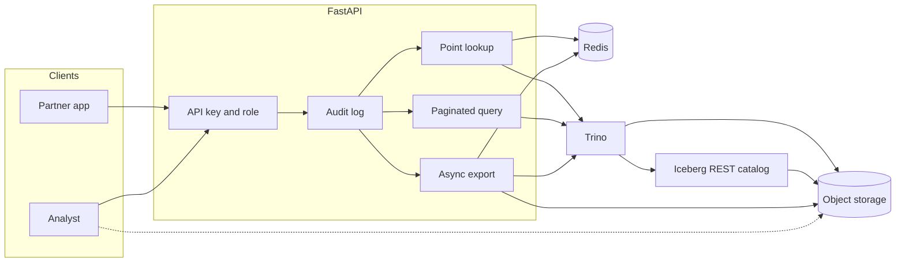
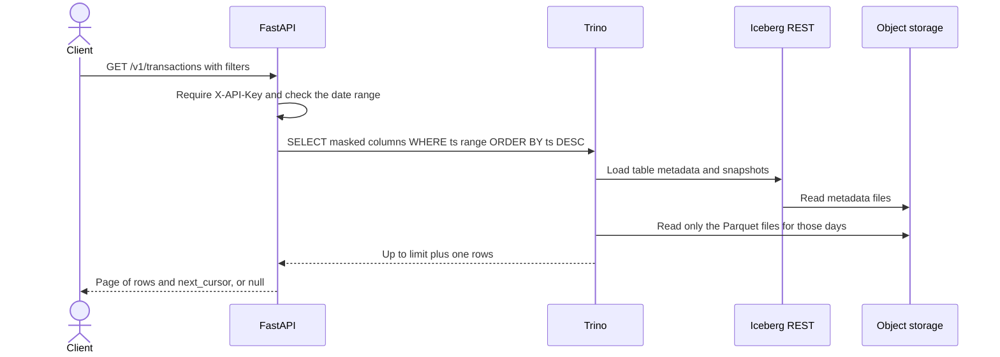
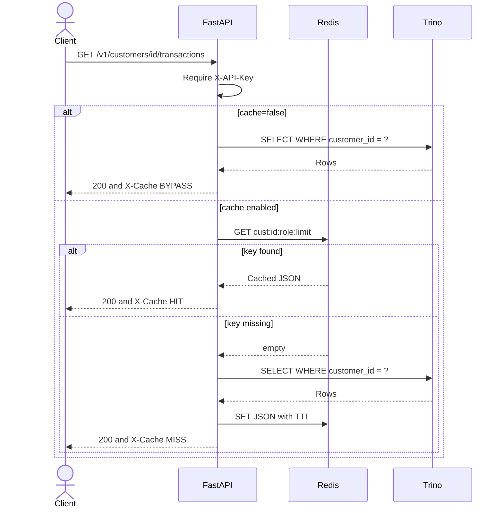
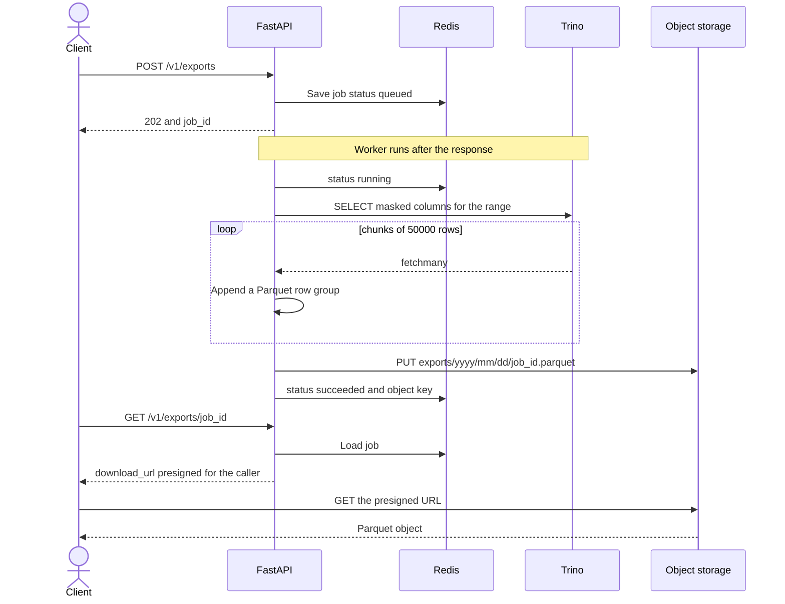

# Architecture

The project is a small lakehouse with an HTTP API in front of it. Files stop being the interface: clients filter, page, look up one customer, or ask for a bulk extract. The lake stays in one place.

Synthetic card transactions live as Parquet in S3-compatible object storage, registered as an Apache Iceberg table. Trino runs the SQL. FastAPI is the only client most callers talk to. Redis covers the one path that has to be fast.

## Components



| Piece | Role in this repo | Image |
|---|---|---|
| Object storage | `warehouse` bucket for the lake, `exports` bucket for Parquet extracts (1-day lifecycle) | `pgsty/silo` |
| Iceberg REST catalog | Table schema, partition spec, snapshots. Metadata stored in SQLite on a volume | `apache/iceberg-rest-fixture` |
| Trino 484 | SQL over Iceberg. One node: the coordinator also runs queries | `trinodb/trino:484` |
| Redis 7 | Cache for point lookups, and export job state | `redis:7-alpine` |
| FastAPI | Auth, masking, pagination, exports | Built from `api/` on `python:3.12-slim` |
| Seed profile | One-off generator. Not started by `make up` | Same image as the API, profile `tools` |

MinIO stopped publishing free container images. Silo is a maintained MinIO fork with the same S3 API, `MINIO_*` variables, console, and `mc` client. Any S3-compatible store can replace it; only endpoints and credentials change. See [Deployment](deployment.md).

Container memory limits for the running stack add up to about 5.2 GB: Trino 3 GB, API 768 MB, Iceberg REST 768 MB, object storage 512 MB, Redis 192 MB. The seed container is separate and limited to 2 GB. Trino's JVM heap is 1.5 GB inside the 3 GB limit (`trino/etc/jvm.config`).

## Data flow

Three endpoints, three shapes of work. The diagrams below match `api/app/main.py`.

### Paginated query

`GET /v1/transactions` is the interactive scan. A date range is required and capped (`MAX_RANGE_DAYS`, default 31) so every query can prune partitions. The predicate is `ts >= start` and `ts < day after date_to`, which lines up with `day(ts)` partitions.



Keyset pagination uses the last `(ts, transaction_id)` instead of `OFFSET`. The next page adds:

```sql
(ts < ? OR (ts = ? AND transaction_id < ?))
```

with `ORDER BY ts DESC, transaction_id DESC`. Page 1000 does not re-read the previous pages. The cursor is the URL-safe Base64 encoding of a JSON array `[timestamp, transaction_id]`. The API asks Trino for `limit + 1` rows and returns a cursor only when that extra row exists.

Details, including error codes, are in the [API reference](api-reference.md).

### Cached point lookup

`GET /v1/customers/{id}/transactions` is the high-TPS path. The filter is `customer_id`, not the partition column, so Trino may open every daily partition. That is the wrong tool to call thousands of times a second. The API checks Redis first.



The Redis key is `cust:{customer_id}:{role}:{limit}`. Role is part of the key so an analyst never receives a cached admin payload, and the other way around. `cache=false` neither reads nor writes Redis (`X-Cache: BYPASS`). That flag exists so a load test can compare the two layers. TTL is `CACHE_TTL_SECONDS` (default 300). Nothing invalidates a key early; this demo has no ingestion stream.

### Async export

`POST /v1/exports` does not stream the body back to the client. Large ranges (up to `MAX_EXPORT_DAYS`, default 366) would tie up an HTTP worker and hold the result in memory. The request records a job in Redis and returns `202`. A thread-pool worker streams Trino into a local Parquet file in chunks of 50,000 rows, uploads it, and stores the object key on the job.



`GET` mints a new presigned URL on every poll (`PRESIGN_SECONDS`, default 3600). The URL is signed for `S3_PUBLIC_ENDPOINT`, because S3 signatures cover the host the downloader will use, not the Docker network name `minio`.

Job state lives in Redis (`export:{job_id}`, TTL 7 days) so any API process can answer `GET`. The worker itself is in-process (`EXPORT_WORKERS` threads per uvicorn process). If that process dies mid-export, the job stays `running` until the key expires. A durable queue is a [roadmap](roadmap.md) item, not a feature of this repo.

Masking is in the `SELECT` list, so an analyst's export file never contains clear card numbers or CPFs. Admin exports do.

## Design decisions

### Trino, not DuckDB

DuckDB would be the simpler engine on one laptop: embedded, no JVM, and often lower latency for a single Parquet scan. It is a good fit when one process both stores and serves the data.

This repo uses Trino because the architecture it demonstrates is the split you meet once more than one service reads the lake:

- Trino plans, schedules splits, and lists Iceberg metadata on every query. That fixed cost is hundreds of milliseconds even for a tiny lookup, which is exactly why point lookups should not hit it on the hot path.
- The same coordinator can grow into workers. The SQL and the catalog do not change.
- PyIceberg (the generator) and Trino share one REST catalog, which is the production shape: writers and readers are different processes.

The cost of that choice is operational weight. Trino needs a JVM heap sized together with the container limit, and a cold point lookup is slow on purpose. See the numbers in [Performance](performance.md). A single-node DuckDB service would teach a different lesson.

### Iceberg, not a pile of Parquet files

A directory of Parquet files has no snapshot, no enforced schema, and no hidden partitioning. Iceberg gives this project:

- A schema (14 columns, `amount` as `decimal(12,2)`) shared by the generator and Trino.
- `day(ts)` partitioning, so a date filter skips whole days of files.
- A sort order of `(customer_id, ts)` inside each file, so Parquet statistics can skip row groups on a point lookup. The lookup is still too slow to be the high-TPS path; the statistics only make the miss cheaper.
- Snapshots, so a reader sees one committed version while the generator appends.

The REST catalog (with a SQLite file on a volume) keeps that metadata across restarts. The fixture image is a reference implementation, not a catalog you would run as a shared service without care. Production catalogs are JDBC/PostgreSQL, AWS Glue, or a dedicated catalog service. The table format in front of them stays Iceberg.

### Keyset pagination, not OFFSET

`OFFSET 100000` still makes the engine produce and discard those rows. A cursor of `(ts, transaction_id)` is a predicate. Both columns are in the `ORDER BY`, and `transaction_id` is unique, so the page boundary is stable even when many rows share a timestamp.

The trade-off: the client cannot jump to page 50. It walks forward. That matches an API consumer pulling a window, and it does not match a UI that renders page numbers. A total count is also absent, because `COUNT(*)` over the window is a second heavy query. The response has `count` for the page, not for the whole filter.

### Async export, not a bigger HTTP response

A quarter of transactions does not belong in a request/response body:

- The API process would buffer or proxy tens of megabytes per caller.
- Trino can take longer than a gateway timeout.
- The useful artifact is a file, and object storage is already where files live.

The worker writes Parquet with ZSTD, in chunks, so memory tracks the chunk size rather than the full result. The client polls, then downloads with a presigned URL and can use PyArrow, DuckDB, or Spark on the file. The API never proxies those bytes.

The trade-off is latency to the first byte and a job lifecycle to operate. Interactive filters stay on `GET /v1/transactions`, which refuses ranges above 31 days and tells the caller to use the export.

### Masking in SQL

Card number and CPF are masked in the SQL text sent to Trino for any role other than `admin`. The clear values are not selected, so they are not in the JSON page and not in the Parquet file. Doing it in Python after a `SELECT *` would leak the clear columns into the export worker's memory and into any future client of Trino that bypasses this API.

The trade-off: the rule lives in this service (`api/app/security.py`), not in the engine. Another Trino user with the same credentials sees clear text. [Security](security.md) describes moving the rule into Trino access control.

### What is intentionally small

- One Trino process, coordinator included in scheduling.
- API-key auth instead of OAuth.
- Export workers inside the API process instead of a queue.
- Cache expiry by TTL instead of event-driven invalidation.
- A fixture REST catalog instead of a highly available one.

Those are the boundaries of a laptop demo. [Roadmap](roadmap.md) is the list of what changes when they are not acceptable.
