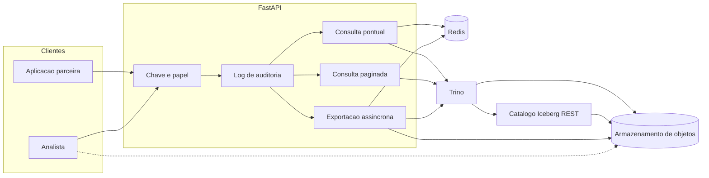
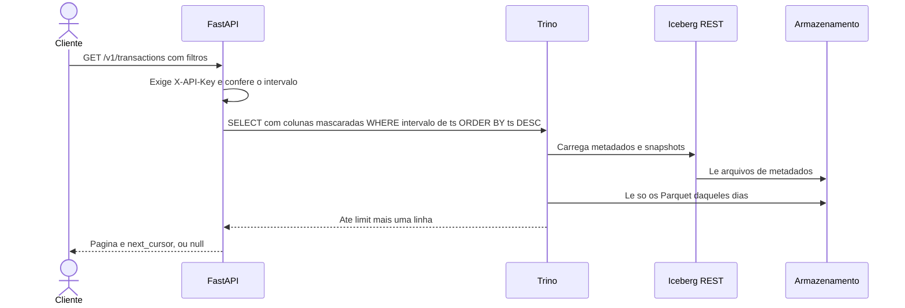
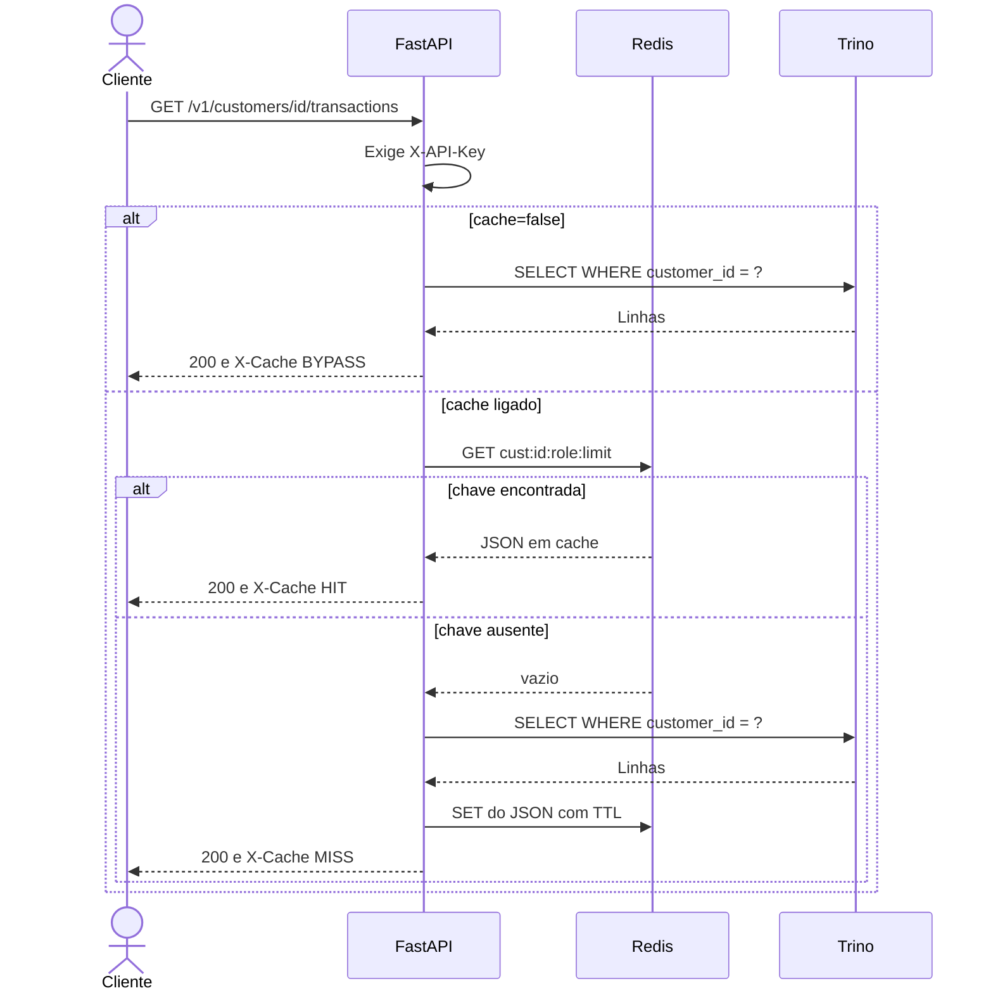
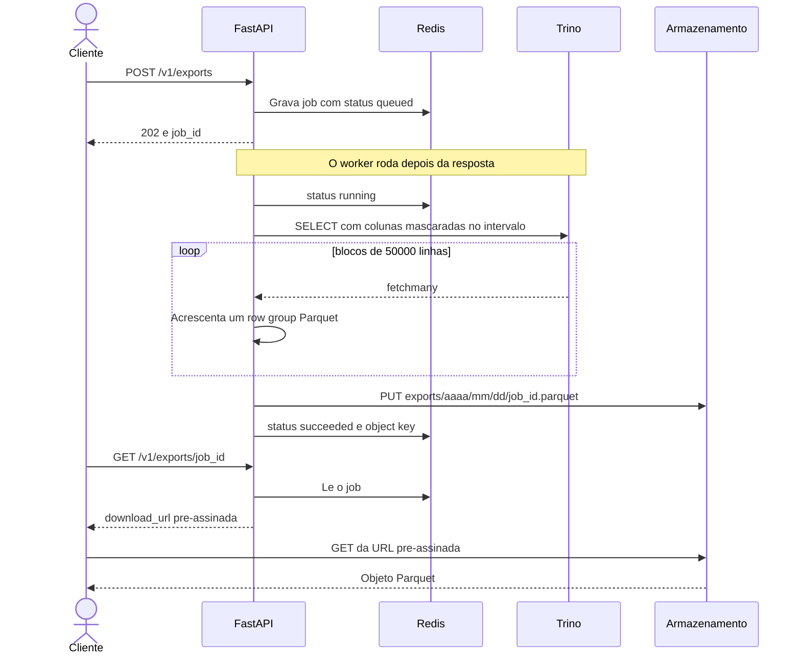

# Arquitetura

O projeto é um lakehouse pequeno com uma API HTTP na frente. O arquivo deixa de ser a interface: o cliente filtra, pagina, consulta um cliente ou pede um extrato grande. O lago fica num só lugar.

Transações de cartão sintéticas ficam em Parquet num armazenamento de objetos compatível com S3, registradas como tabela Apache Iceberg. O Trino executa o SQL. O FastAPI é o único cliente com que a maioria dos chamadores fala. O Redis cobre o único caminho que precisa ser rápido.

## Componentes



| Peça | Papel neste repositório | Imagem |
|---|---|---|
| Armazenamento de objetos | Bucket `warehouse` para o lago, bucket `exports` para extratos Parquet (ciclo de vida de 1 dia) | `pgsty/silo` |
| Catálogo Iceberg REST | Esquema, particionamento, snapshots. Metadados em SQLite num volume | `apache/iceberg-rest-fixture` |
| Trino 484 | SQL sobre Iceberg. Um nó: o coordinator também executa as consultas | `trinodb/trino:484` |
| Redis 7 | Cache das consultas pontuais e estado dos jobs de exportação | `redis:7-alpine` |
| FastAPI | Autenticação, mascaramento, paginação, exportações | Construída a partir de `api/` em `python:3.12-slim` |
| Perfil seed | Gerador avulso. Não sobe com `make up` | A mesma imagem da API, perfil `tools` |

O MinIO parou de publicar imagens gratuitas de contêiner. O Silo é um fork mantido do MinIO, com a mesma API S3, as mesmas variáveis `MINIO_*`, o console e o cliente `mc`. Qualquer armazenamento compatível com S3 pode substituí-lo; mudam só o endpoint e as credenciais. Veja [Implantação](deployment.md).

Os limites de memória dos contêineres em execução somam cerca de 5.2 GB: Trino 3 GB, API 768 MB, Iceberg REST 768 MB, armazenamento 512 MB, Redis 192 MB. O contêiner de seed é separado e limitado a 2 GB. O heap da JVM do Trino é 1.5 GB dentro do limite de 3 GB (`trino/etc/jvm.config`).

## Fluxo de dados

Três endpoints, três formas de trabalho. Os diagramas abaixo seguem `api/app/main.py`.

### Consulta paginada

`GET /v1/transactions` é a leitura interativa. O intervalo de datas é obrigatório e tem teto (`MAX_RANGE_DAYS`, padrão 31) para que toda consulta possa podar partições. O predicado é `ts >= início` e `ts < o dia seguinte a date_to`, alinhado às partições `day(ts)`.



A paginação por cursor (keyset) usa o último `(ts, transaction_id)` em vez de `OFFSET`. A página seguinte acrescenta:

```sql
(ts < ? OR (ts = ? AND transaction_id < ?))
```

com `ORDER BY ts DESC, transaction_id DESC`. A página 1000 não relê as páginas anteriores. O cursor é o Base64 seguro para URL de um array JSON `[timestamp, transaction_id]`. A API pede `limit + 1` linhas ao Trino e só devolve cursor quando essa linha extra existe.

Os códigos de erro estão na [referência da API](api-reference.md).

### Consulta pontual com cache

`GET /v1/customers/{id}/transactions` é o caminho de alto TPS. O filtro é `customer_id`, não a coluna de partição, então o Trino pode abrir cada partição diária. Essa não é a ferramenta para chamar milhares de vezes por segundo. A API olha o Redis primeiro.



A chave no Redis é `cust:{customer_id}:{role}:{limit}`. O papel entra na chave para que um analista nunca receba o payload de um admin, e o contrário também. `cache=false` não lê nem grava o Redis (`X-Cache: BYPASS`). A flag existe para o teste de carga comparar as duas camadas. O TTL é `CACHE_TTL_SECONDS` (padrão 300). Nada invalida a chave antes da hora; esta demonstração não tem fluxo de ingestão.

### Exportação assíncrona

`POST /v1/exports` não devolve o corpo ao cliente. Intervalos grandes (até `MAX_EXPORT_DAYS`, padrão 366) prenderiam um worker HTTP e segurariam o resultado na memória. A requisição grava um job no Redis e responde `202`. Um worker de thread pool transmite o Trino para um Parquet local em blocos de 50,000 linhas, envia o arquivo e guarda a chave do objeto no job.



O `GET` emite uma URL pré-assinada nova a cada consulta (`PRESIGN_SECONDS`, padrão 3600). A URL é assinada para `S3_PUBLIC_ENDPOINT`, porque a assinatura S3 cobre o host que quem baixa vai usar, não o nome `minio` da rede Docker.

O estado do job fica no Redis (`export:{job_id}`, TTL de 7 dias), então qualquer processo da API responde o `GET`. O worker em si é interno ao processo (`EXPORT_WORKERS` threads por processo uvicorn). Se o processo morre no meio da exportação, o job permanece `running` até a chave expirar. Uma fila durável está no [roteiro](roadmap.md), não neste repositório.

O mascaramento está na lista do `SELECT`, então o arquivo de um analista nunca contém cartão ou CPF claros. O de um admin contém.

## Decisões de desenho

### Trino, não DuckDB

O DuckDB seria o motor mais simples num laptop: embutido, sem JVM, e em geral com latência menor numa varredura Parquet só. Serve bem quando um único processo guarda e serve o dado.

Este repositório usa Trino porque a arquitetura que ele mostra é a divisão que aparece quando mais de um serviço lê o lago:

- O Trino planeja, agenda splits e lista metadados Iceberg em toda consulta. Esse custo fixo é de centenas de milissegundos mesmo num lookup pequeno, e é exatamente por isso que a consulta pontual não deve ir ao Trino no caminho quente.
- O mesmo coordinator pode ganhar workers. O SQL e o catálogo não mudam.
- O PyIceberg (o gerador) e o Trino compartilham um catálogo REST, que é a forma de produção: quem escreve e quem lê são processos diferentes.

O custo dessa escolha é operacional. O Trino precisa de um heap de JVM dimensionado junto com o limite do contêiner, e um lookup frio é lento de propósito. Os números estão em [Desempenho](performance.md). Um serviço DuckDB de um nó ensinaria outra lição.

### Iceberg, não uma pilha de arquivos Parquet

Um diretório de Parquet não tem snapshot, não impõe esquema e não tem particionamento oculto. O Iceberg dá a este projeto:

- Um esquema (14 colunas, `amount` como `decimal(12,2)`) compartilhado pelo gerador e pelo Trino.
- Particionamento `day(ts)`, então um filtro de data pula dias inteiros de arquivos.
- Ordem `(customer_id, ts)` dentro de cada arquivo, então as estatísticas Parquet podem pular row groups num lookup. O lookup continua lento demais para ser o caminho de alto TPS; as estatísticas só barateiam o miss.
- Snapshots, então o leitor vê uma versão commitada enquanto o gerador faz append.

O catálogo REST (com um SQLite num volume) guarda esses metadados entre reinícios. A imagem fixture é uma implementação de referência, não um catálogo para operar como serviço compartilhado sem cuidado. Catálogos de produção são JDBC/PostgreSQL, AWS Glue ou um serviço dedicado. O formato da tabela na frente deles continua Iceberg.

### Paginação por cursor, não OFFSET

`OFFSET 100000` ainda faz o motor produzir e descartar essas linhas. Um cursor de `(ts, transaction_id)` é um predicado. As duas colunas estão no `ORDER BY`, e `transaction_id` é único, então a fronteira da página fica estável mesmo quando muitas linhas compartilham o timestamp.

A troca: o cliente não salta para a página 50. Ele anda para a frente. Isso combina com um consumidor de API puxando uma janela, e não combina com uma UI de número de página. Também não há contagem total, porque `COUNT(*)` na janela é uma segunda consulta pesada. A resposta traz `count` da página, não do filtro inteiro.

### Exportação assíncrona, não uma resposta HTTP maior

Um trimestre de transações não cabe num corpo de requisição e resposta:

- O processo da API bufferizaria ou faria proxy de dezenas de megabytes por chamador.
- O Trino pode passar do timeout de um gateway.
- O artefato útil é um arquivo, e o armazenamento de objetos já é onde arquivo mora.

O worker grava Parquet com ZSTD, em blocos, então a memória acompanha o tamanho do bloco, não o resultado inteiro. O cliente consulta o job e baixa por URL pré-assinada, e pode usar PyArrow, DuckDB ou Spark no arquivo. A API não faz proxy desses bytes.

A troca é a latência até o primeiro byte e um ciclo de vida de job para operar. Filtros interativos ficam em `GET /v1/transactions`, que recusa intervalos acima de 31 dias e manda o chamador usar a exportação.

### Mascaramento no SQL

Cartão e CPF são mascarados no texto SQL enviado ao Trino para qualquer papel que não seja `admin`. Os valores claros não são selecionados, então não estão na página JSON nem no Parquet. Fazer isso em Python depois de um `SELECT *` vazaria as colunas claras para a memória do worker e para qualquer cliente futuro do Trino que ignore esta API.

A troca: a regra vive neste serviço (`api/app/security.py`), não no motor. Outro usuário do Trino com as mesmas credenciais vê o texto claro. [Segurança](security.md) descreve mover a regra para o controle de acesso do Trino.

### O que é pequeno de propósito

- Um processo Trino, com o coordinator incluído no agendamento.
- Autenticação por chave de API em vez de OAuth.
- Workers de exportação dentro do processo da API, em vez de uma fila.
- Expiração de cache por TTL, em vez de invalidação por evento.
- Um catálogo REST fixture, em vez de um altamente disponível.

Esses são os limites de uma demonstração de laptop. O [roteiro](roadmap.md) é a lista do que muda quando eles deixam de ser aceitáveis.
